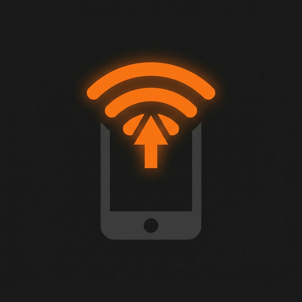
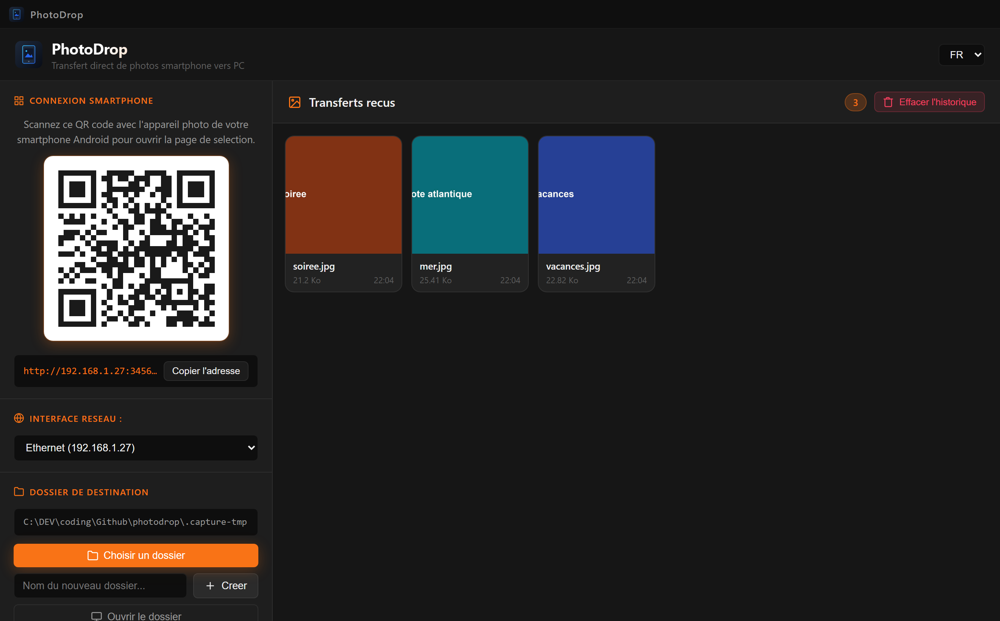

<div align="center">



# PhotoDrop

**Transfer photos from a phone straight to a folder on the desktop, over the local network. No cloud, no account.**

[](LICENSE)
[](https://github.com/infinition/photodrop/releases)
[](https://www.electronjs.org/)

[English](#english) | [Français](#francais)

</div>

---

<a name="english"></a>

## English

Photographing something and moving the pictures to the computer is still a
chore. Cables, accounts, mail to yourself, or an upload service you never asked
for.

PhotoDrop replaces all of that with a page on the local network. The desktop app
serves a small website and shows its address as a QR code. Scan it with the
phone camera, pick the photos, send them: they stream over Wi-Fi into a folder
on the desktop. Nothing travels through the internet, there is no account to
create.

The destination folder is resolved through the operating system, not assumed.
Whether the system calls it Desktop, Bureau, Schreibtisch or something else, on
Windows, macOS or Linux, the transfer lands in the real desktop folder of the
session.

<div align="center">

</div>

<p align="center"><i>Each received photo appears live. Double clicking one opens it fullscreen, with zoom, previous and next, and the arrow keys.</i></p>

### What it does

| Feature | Detail |
| --- | --- |
| Live over Wi-Fi | the phone opens a page served by the desktop, no app to install on the phone |
| Real desktop folder | `Desktop`, `Bureau`, whatever the account language calls it, on Windows, macOS and Linux |
| One folder per shoot | `+ Creer` makes a subfolder inside the current one and empties the viewer, so the thumbnails always match where the next photos will land |
| Fullscreen viewer | double click a thumbnail: zoom with the wheel or `+`/`-`, drag to pan, `ArrowLeft`/`ArrowRight` to move, `Esc` to close |
| Open in Explorer or Finder | one button reveals the target folder |
| Video too | the same flow accepts video files |
| Private | nothing leaves the network, no account, no log-in |

### Getting started

```bash
npm ci
npm start
```

PhotoDrop is an Electron app: the window opens, the server starts on port 3456
and the QR code appears. Under Windows, `run.bat` does the same from a double
click. The phone must be on the same Wi-Fi or local network.

Scanning the QR code opens `http://<pc-address>:3456/mobile`. The page can be
added to the home screen like an app. Selecting photos, taking one with the
camera, or sending existing ones all go through the same transfer.

### Releases

| Platform | Package |
| --- | --- |
| Windows 10/11, x64 | NSIS installer and portable EXE |
| macOS, Apple Silicon | DMG |
| Linux, x64 | AppImage |

On macOS the app is not signed. After the first download, lift the quarantine:

```
xattr -cr /Applications/PhotoDrop.app
```

### From the browser only

No need to install anything to try it: `npm run server` starts the same server
without the Electron window. Point a browser on the PC to
http://localhost:3456 and the phone to the address shown there.

`PORT` overrides the default port 3456.

### Project layout

- `electron/` : the desktop shell, desktop resolution, native menus and dialogs
- `server.js` : the HTTP server, uploads, Server-Sent Events, folder management
- `public/` : the PC dashboard and the phone page, responsive, safe-area aware
- `locales/` : translations, French and English, loaded by key
- `tools/` : icon export and the headless captures of this README
- `docs/` : screenshots

<a name="francais"></a>

## Français

Prendre des photos puis les retrouver sur l'ordinateur reste une corvee.
Cables, comptes, mails qu'on se renvoie, ou service de depot qu'on n'a jamais
demande.

PhotoDrop remplace tout cela par une page sur le reseau local. L'application de
bureau sert un petit site et en affiche l'adresse sous forme de code QR.
Scannez-le avec l'appareil photo du telephone, choisissez les photos, envoyez:
elles arrivent par le Wi-Fi dans un dossier sur le Bureau. Rien ne transite par
internet, il n'y a aucun compte a creer.

Le dossier de destination est resolu par le systeme, jamais suppose. Que le
systeme l'appelle Desktop, Bureau ou autre chose, sous Windows, macOS ou Linux,
le transfert aboutit dans le vrai dossier du Bureau de la session.

<div align="center">

</div>

<p align="center"><i>Chaque photo recue apparait en direct. Un double clic l'ouvre en plein ecran, avec zoom, precedente et suivante, et les fleches du clavier.</i></p>

### Ce que ca fait

| Fonction | Detail |
| --- | --- |
| Direct par Wi-Fi | le telephone ouvre une page servie par le bureau, rien a installer sur le telephone |
| Vrai dossier du Bureau | `Desktop`, `Bureau`, peu importe la langue du compte, sous Windows, macOS et Linux |
| Un dossier par prise de vue | `+ Creer` fait un sous-dossier dans le dossier courant et vide le visualiseur: les vignettes correspondent toujours au dossier ou tomberont les photos |
| Visionneuse plein ecran | double clic sur une vignette: zoom a la molette ou avec `+`/`-`, glisser pour deplacer, `ArrowLeft`/`ArrowRight` pour passer, `Esc` pour fermer |
| Ouvrir dans l'Explorateur | un bouton affiche le dossier de destination |
| Les videos aussi | le meme flux accepte les fichiers video |
| Prive | rien ne quitte le reseau, pas de compte, pas de connexion |

### Demarrer

```bash
npm ci
npm start
```

PhotoDrop est une application Electron: la fenetre s'ouvre, le serveur demarre
sur le port 3456 et le code QR apparait. Sous Windows, `run.bat` fait la meme
chose d'un double clic. Le telephone doit etre sur le meme Wi-Fi ou le meme
reseau local.

Scanner le code QR ouvre `http://<adresse-du-pc>:3456/mobile`. La page peut
etre ajoutee a l'ecran d'accueil comme une application. Choisir des photos, en
prendre une avec l'appareil photo ou envoyer celles qui existent passe par le
meme transfert.

### Versions

| Plateforme | Paquet |
| --- | --- |
| Windows 10/11, x64 | installeur NSIS et EXE portable |
| macOS, Apple Silicon | DMG |
| Linux, x64 | AppImage |

Sur macOS l'application n'est pas signee. Apres le premier telechargement,
levez la quarantaine:

```
xattr -cr /Applications/PhotoDrop.app
```

### Sans le bureau

Pas besoin d'installer pour essayer: `npm run server` demarre le meme serveur
sans la fenetre Electron. Ouvrez un navigateur sur le PC a l'adresse
http://localhost:3456, et le telephone a l'adresse affichee la.

`PORT` remplace le port par defaut 3456.

### Structure du projet

- `electron/` : la coquille de bureau, resolution du Bureau, menus et boites natives
- `server.js` : le serveur HTTP, les envois, les Server-Sent Events, la gestion des dossiers
- `public/` : le tableau de bord PC et la page telephone, responsive, marges d'encoche gerees
- `locales/` : les traductions, francais et anglais, chargees par cle
- `tools/` : export des icones et les captures headless de ce README
- `docs/` : les captures d'ecran
